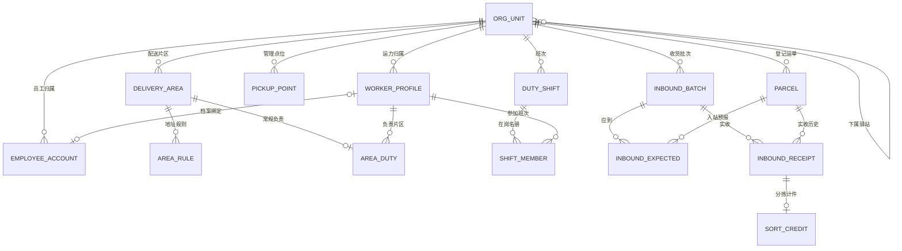
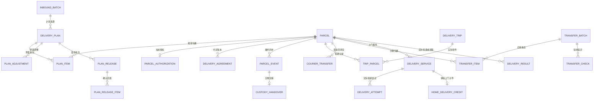
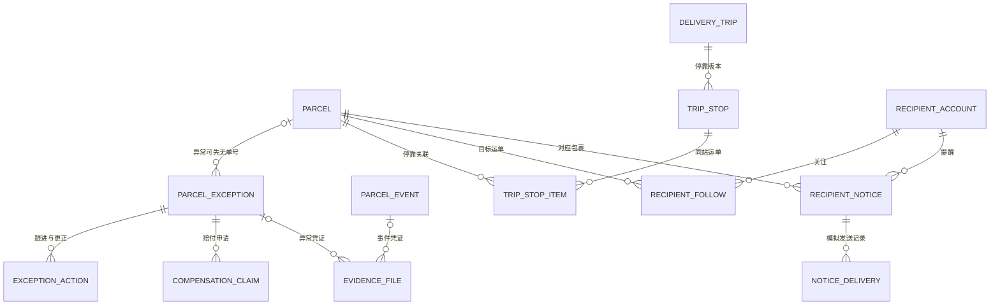

# 数据库设计

本页定义表结构、实体关系和并发约束。业务流程见[项目手册](PROJECT.md)，写入归属见[模块设计](MODULES.md)，实际 DDL 随对应 Spec 以 Flyway 迁移交付。

以运单 `000726050018` 为例。上游清单有该票时只能得知「应到」。扫码后才有「实收」。计划发布给陈立后，陈立获得领件授权，包裹仍在网点。陈立实际扫码领走后，保管才转给陈立。失败返站时，网点再次实际收回才恢复本站库存。数据库分别保存这些事实，并能按同一个运单号追溯。

## 字段约定

| 项目 | 约定 |
| --- | --- |
| 主键及版本 | `id` 为 `BIGINT` 自增主键，`*_id` 与被引用主键类型一致。`version` 为 `BIGINT NOT NULL DEFAULT 0`，业务更新时加一。表内另注明复合主键。 |
| 必填与引用 | 表中字段默认 `NOT NULL`，`?` 表示可空。`FK → 表名` 默认引用该表主键。`UQ` 是唯一键，`IX` 是普通索引。外键默认限制删除，已有业务引用时通过状态停用或作废。 |
| 编码及时间 | InnoDB、`utf8mb4`。`waybill_no VARCHAR(64)` 按字符串精确匹配，保留前导零。业务代码使用 `VARCHAR`，命名和允许值由对应 Spec 的迁移明确。`*_at`、`*_from`、`*_until` 为 UTC `DATETIME(6)`，业务日期为 `DATE`，日统计用所属单位时区。 |
| 金额、坐标及凭证 | 金额用 `DECIMAL(12,2)`，币种 `CHAR(3)`，计数用 `INT`。经纬度 `DECIMAL(10,7)` 并记录坐标系。照片只在库里保存受控对象引用及元数据。 |
| 数据边界 | MySQL 保存可追溯的业务状态和事件。Redis 保存趟次最近位置。账号会话、地图路段及估时保留各自生命周期。 [MySQL CHECK 约束](https://dev.mysql.com/doc/refman/8.4/en/create-table-check-constraints.html) |

## ER 图

### 组织、账号与入站

### 授权、分拨与实际交接

### 异常、在途与收件人查询

图中的主体关系区分业务对象。身份、事件、版本与其他关联字段以以下表结构为准。

## 表结构

简写 `代码` 为 `VARCHAR(32)`，`说明` 为 `VARCHAR(512)`，`名称` 为 `VARCHAR(128)`。表中 `版本` 使用前述 `version` 约定。每行列出该表的业务字段及关键约束。

通用外键命名如下。`network_id`、`*_unit_id`、`unit_id`、`station_id` 指向 `org_unit`。`*_worker_id`、`worker_id`、`driver_id`、`assignee_id` 指向 `worker_profile`。`*_area_id`、`area_id` 指向 `delivery_area`。`*_event_id`、`event_id` 指向 `parcel_event`。`*_by`、`employee_id`、`actor_employee_id`、`approved_by`、`handler_id`、`applicant_id` 指向 `employee_account`。`actor_id` 在异常跟进中指员工，在操作回执中按 `actor_type` 解读。证据中的 `object_key` 指向受控文件存储。

同网点、同驿站和角色一致性涉及多表，业务写入时在事务内校验。可在行内判断的必填组合、金额和时间区间使用 `CHECK` 约束。生成列的表达式由对应 Spec 的有效状态定义。历史引用使用相同实体标识，防止账号停用、人员变动或档案编辑影响历史查证。

### 网点、运力、账号

| 表 · 写入模块 | 字段 | 关系和约束 |
| --- | --- | --- |
| `org_unit` · station | `id`, `kind 代码`, `parent_id?`, `code 代码`, `name 名称`, `timezone VARCHAR(64)`, `business_phone? VARCHAR(32)`, `active BOOLEAN` | `parent_id` 自关联。派件网点无上级，下属驿站必须挂派件网点。`UQ(code)`。 |
| `delivery_area` · station | `id`, `network_id`, `code 代码`, `name 名称`, `active BOOLEAN` | `network_id → org_unit` 必须是网点。`UQ(network_id, code)`。驿站和外部点位用已有片区数据。 |
| `area_rule` · station | `id`, `network_id`, `street 名称`, `community 名称`, `area_id`, `active BOOLEAN`, `updated_by` | `area_id → delivery_area`，与网点一致。`UQ(network_id, street, community)`。更正修改现有规则，原包裹片区由履约更正。 |
| `worker_profile` · station | `id`, `unit_id`, `worker_no 代码`, `kind 代码`, `display_name 名称`, `business_phone? VARCHAR(32)`, `active BOOLEAN` | `unit_id → org_unit`。区分网点配送员、驿站配送员、转运司机。`UQ(unit_id, worker_no)`。 |
| `area_duty` · station | `area_id`, `worker_id`, `updated_by`, `updated_at` | `PK(area_id)`，`worker_id → worker_profile`，限定本网点配送员。一次性临时换人写计划。 |
| `duty_shift` · station | `id`, `unit_id`, `service_date DATE`, `code 代码`, `starts_at`, `ends_at` | `UQ(unit_id, service_date, code)`。`starts_at < ends_at`。 |
| `shift_member` · station | `shift_id`, `worker_id`, `duty_status 代码`, `reason? 说明`, `updated_by`, `version` | `PK(shift_id, worker_id)`，两者所属单位相同。在岗或请假在此查询。 |
| `pickup_point` · station | `id`, `network_id`, `site_unit_id?`, `area_id`, `kind 代码`, `name 名称`, `address 说明`, `business_phone? VARCHAR(32)`, `active BOOLEAN` | `site_unit_id → org_unit` 用于本组织自取点。柜机、商铺使用点位记录。`area_id → delivery_area` 且同网点。 |
| `employee_account` · identity | `id`, `unit_id`, `worker_id?`, `login_name VARCHAR(64)`, `password_hash VARCHAR(100)`, `role_code 代码`, `status 代码`, `must_change_password BOOLEAN`, `session_version BIGINT` | `UQ(login_name)`、`UQ(worker_id)`。可登录人员与运力档案分开。关联档案时岗位和所属单位须一致。网点、驿站共用工作台时，仍按账号岗位与单位判断数据范围。 |
| `recipient_account` · identity | `id`, `normalized_phone VARCHAR(20)`, `status 代码`, `verified_at?` | `UQ(normalized_phone)`。与员工账号、单位及岗位独立。验证码保存在短时存储，绑定用途、到期、验证次数及一次性使用标记。 |

### 包裹、入站和作业计件

| 表 · 写入模块 | 字段 | 关系和约束 |
| --- | --- | --- |
| `parcel` · fulfillment | `id`, `network_id`, `waybill_no`, `recipient_phone? VARCHAR(20)`, `street? 名称`, `community? 名称`, `address? 说明`, `address_area_id?`, `stage 代码`, `holder_kind 代码`, `holder_unit_id?`, `holder_worker_id?`, `holder_point_id?`, `version`, `created_at`, `updated_at` | `UQ(network_id, waybill_no)`。`IX(recipient_phone, id)`、`IX(holder_unit_id, stage, id)`。保管字段按类型互斥，未实收可无实物持有人。`address_area_id` 是收件地址片区。 |
| `inbound_batch` · fulfillment | `id`, `network_id`, `source_system 代码`, `source_batch_no VARCHAR(64)`, `reconciled_at?`, `reconciled_by?`, `version` | `UQ(network_id, source_system, source_batch_no)`。批次核对前显示未扫，核对后才形成可信应到未收。 |
| `inbound_expected` · fulfillment | `batch_id`, `parcel_id`, `source_line_no? VARCHAR(64)`, `imported_at` | `PK(batch_id, parcel_id)`。关联同网点包裹。导入应到仅建立预报；实收从入站记录统计。 |
| `inbound_receipt` · fulfillment | `id`, `batch_id`, `parcel_id`, `scan_event_id`, `received_by`, `received_at`, `matched_area_id?`, `void_event_id?`, `voided_at?`, `active_parcel_id?` | `scan_event_id → parcel_event`。生成列 `active_parcel_id` 仅在未作废时为 `parcel_id`，`UQ(active_parcel_id)`。保留原片区、原扫码和作废证据。 |
| `sort_credit` · fulfillment | `receipt_id`, `unit_id`, `employee_id`, `source_event_id`, `credited_at`, `void_event_id?` | `PK(receipt_id)`。有效实收命中片区计给扫码人，待分区在首次有效补分后计给补分人。`IX(unit_id, employee_id, credited_at)`。作废与计件撤销同事务。驿站上架作为已签收后的独立作业事件供查数量。 |
| `delivery_agreement` · fulfillment | `id`, `parcel_id`, `version`, `method 代码`, `target_area_id?`, `pickup_point_id?`, `home_address? 说明`, `confirmation_source 代码`, `confirmed_by?`, `confirmed_at`, `consent_reference? 说明`, `superseded_at?`, `active_parcel_id?` | `UQ(parcel_id, version)`、`UQ(active_parcel_id)`。上门保留地址快照；到点自取引用确认的点位。目的地片区供直派分堆，不改原收件地址片区。 |

站内库存用当前保管单位和实际在站状态查询。可安排清单还需校验有效投递约定、目标分区和拦截放行状态。破损隔离件、未签收差异和待联系返站件要各自能查。

### 计划、现行授权、趟次与交接

| 表 · 写入模块 | 字段 | 关系和约束 |
| --- | --- | --- |
| `delivery_plan` · planning | `id`, `network_id`, `shift_id`, `inbound_batch_id`, `created_by`, `created_at`, `status 代码`, `version` | 关联同一网点的入站批次、班次和操作人。`IX(network_id, shift_id, status)`。 |
| `plan_item` · planning | `plan_id`, `parcel_id`, `target_area_id?`, `proposed_worker_id?`, `parcel_version BIGINT`, `reason_code? 代码` | `PK(plan_id, parcel_id)`。保存拟领件人、留站或未安排理由。草案只引用当时包裹版本。 |
| `plan_adjustment` · planning | `id`, `plan_id`, `parcel_id`, `plan_version BIGINT`, `old_worker_id?`, `new_worker_id?`, `reason 说明`, `changed_by`, `changed_at` | 调整和草案更新同事务。逐票保存临时改人或留站原因，便于对照发布版本。 |
| `plan_release` · planning | `id`, `plan_id`, `release_no INT`, `plan_version BIGINT`, `published_by`, `published_at` | `UQ(plan_id, release_no)`。每次明确确认的发布或直接改派在此建一批。 |
| `plan_release_item` · planning | `release_id`, `parcel_id`, `worker_id`, `authorized_event_id` | `PK(release_id, parcel_id)`。绑定提交成功的逐票授权事件，能查历史有效范围。 |
| `parcel_authorization` · fulfillment | `parcel_id`, `kind 代码`, `status 代码`, `unit_id`, `authorized_worker_id?`, `target_unit_id?`, `shift_id?`, `release_id?`, `transfer_item_id?`, `service_id?`, `consent_id?`, `valid_until?`, `version` | `PK(parcel_id)`。直派、分拨、驿站上门共用现行授权槽位，按来源留下对应外键。收费续派关联 `redelivery_consent`。撤销、替换及使用追加履约事件，和保管事实分开。`IX(unit_id, authorized_worker_id, status, parcel_id)`。 |
| `delivery_trip` · fulfillment | `id`, `origin_unit_id`, `worker_id`, `shift_id`, `status 代码`, `opened_at`, `closed_at?`, `route_version BIGINT`, `version`, `active_worker_id?` | 首次成功领件建趟。生成列仅开放趟次取 `worker_id`，`UQ(active_worker_id)`。空趟不因查看候领清单创建。 |
| `trip_parcel` · fulfillment | `id`, `trip_id`, `parcel_id`, `received_event_id`, `closed_event_id?`, `outcome? 代码`, `active_parcel_id?` | `UQ(received_event_id)`，生成列 `active_parcel_id` 对尚未结束的趟次明细取 `parcel_id` 并唯一。`IX(trip_id, outcome, parcel_id)`。回库关闭原明细但保留记录，下一次真正领件可新建明细。 |
| `courier_transfer` · fulfillment | `id`, `parcel_id`, `from_worker_id`, `to_worker_id`, `approved_by`, `reason 说明`, `status 代码`, `out_event_id?`, `in_event_id?`, `version` | 出、入分别关联交接事件。接手确认前仍由原配送员保管。同票未结束转交由包裹行加锁控制。 |
| `parcel_event` · fulfillment | `id`, `parcel_id`, `event_type 代码`, `actor_employee_id?`, `actor_unit_id?`, `operation_receipt_id?`, `device_ref? VARCHAR(64)`, `occurred_at`, `details JSON` | 只追加。`IX(parcel_id, occurred_at, id)`、`IX(operation_receipt_id)`。详情记录更正、改派的前后值和理由。业务查询条件保存在关系字段。 |
| `custody_handover` · fulfillment | `event_id`, `from_kind 代码`, `from_unit_id?`, `from_worker_id?`, `from_point_id?`, `to_kind 代码`, `to_unit_id?`, `to_worker_id?`, `to_point_id?`, `condition_code? 代码` | `PK(event_id)`，引用 `parcel_event`。保管的参与方保留原始关系，含网点、驿站、配送员、司机、外部点位、收件人及退回渠道。 |
| `operation_receipt` · 各业务写入模块 | `id`, `actor_type 代码`, `actor_id BIGINT`, `command 代码`, `operation_key VARCHAR(64)`, `request_hash BINARY(32)`, `result JSON`, `committed_at` | `UQ(actor_type, actor_id, command, operation_key)`。保存安全可重放的业务结果。同一标识不同输入拒绝。一次批处理可关联多票履约事件。 |

### 分拨、驿站服务与实际投递

| 表 · 写入模块 | 字段 | 关系和约束 |
| --- | --- | --- |
| `transfer_batch` · pickup-station | `id`, `network_id`, `target_unit_id`, `driver_id`, `batch_no VARCHAR(64)`, `status 代码`, `published_by`, `published_at`, `version` | `UQ(network_id, batch_no)`。目标是该网点下的驿站，司机是本网点转运司机。 |
| `transfer_item` · pickup-station | `id`, `batch_id`, `parcel_id`, `sent_event_id?`, `received_event_id?`, `returned_event_id?` | `UQ(batch_id, parcel_id)`。分别引用实际出库、驿站实收与网点收回事件。没有已发事件的条目仍在网点待发。 |
| `transfer_check` · pickup-station | `id`, `batch_id`, `item_id?`, `parcel_id?`, `observed_waybill_no? VARCHAR(64)`, `difference_type 代码`, `exception_id`, `operation_receipt_id`, `checked_by`, `driver_confirmed_at?`, `checked_at` | 无应收条目的错件仍可登记。缺件、破损和错件持有独立异常；同一提交的差异按操作标识去重。 |
| `delivery_service` · 业务服务来源模块 | `id`, `parcel_id`, `source 代码`, `origin_unit_id`, `agreement_id`, `requested_at`, `created_by`, `assignee_id?`, `status 代码`, `version`, `active_parcel_id?` | 网点直派上门由履约写入，驿站改上门由 `pickup-station` 写入。`UQ(active_parcel_id)`。同一服务换人和返站后的续派沿用稳定 ID。 |
| `redelivery_consent` · 业务服务来源模块 | `id`, `service_id`, `fee_amount`, `currency`, `scheduled_from?`, `scheduled_until?`, `consent_reference 说明`, `recorded_by`, `confirmed_at`, `status 代码` | 费用告知和同意确认留存，续派授权引用生效的同意记录。这里记录客户费用约定。 |
| `delivery_attempt` · fulfillment | `id`, `service_id`, `trip_parcel_id`, `attempt_key VARCHAR(64)`, `attempt_no INT`, `attempted_at`, `result_code 代码`, `reason_code? 代码`, `counts_for_allowance BOOLEAN`, `event_id` | `UQ(service_id, attempt_key)`、`UQ(service_id, attempt_no)`。重报沿用原标识，有效尝试次数按允许计次的记录汇总。 |
| `delivery_result` · fulfillment | `id`, `parcel_id`, `service_id?`, `attempt_id?`, `event_id`, `kind 代码`, `actual_point_id?`, `point_name_snapshot? 名称`, `destination_snapshot? 说明`, `pickup_reference? VARCHAR(128)`, `completed_at`, `supersedes_result_id?` | `UQ(event_id)`。区分上门交付、点位接收、备好待取与实际领取。更正保留原结果，领取与点位接收可分别查时间。 |
| `home_delivery_credit` · pickup-station | `service_id`, `station_id`, `completed_worker_id`, `completed_event_id`, `unit_price`, `currency`, `completed_at` | `PK(service_id)`，`IX(station_id, completed_worker_id, completed_at)`。实际交付、服务完成与计件同事务。以实际完成人和完成时单价快照核对。 |

### 异常、证据、在途及通知

| 表 · 写入模块 | 字段 | 关系和约束 |
| --- | --- | --- |
| `parcel_exception` · fulfillment | `id`, `network_id`, `parcel_id?`, `temp_no? VARCHAR(64)`, `inbound_batch_id?`, `transfer_batch_id?`, `kind 代码`, `discovered_phase 代码`, `discovered_unit_id`, `last_handover_event_id?`, `responsible_unit_id?`, `responsible_worker_id?`, `handling_unit_id`, `handler_id?`, `status 代码`, `discovered_at`, `due_at?`, `version` | `UQ(network_id, temp_no)`。无单号先用临时号，补绑原运单。按来源引用上游入站批次或驿站分拨批次。`IX(handling_unit_id, status, due_at, id)`、`IX(status, due_at, id)`。实际保管和责任归口按交接证据分别核对。 |
| `exception_action` · fulfillment | `id`, `exception_id`, `event_id?`, `action_type 代码`, `actor_id?`, `acted_at`, `reason 说明`, `details JSON` | 追加线上跟进、联系客户、补号、放行、超时、找回与结案记录。已关联包裹的实际交接经履约事件写入。 |
| `compensation_claim` · fulfillment | `id`, `exception_id`, `applicant_id`, `status 代码`, `basis 说明`, `submitted_at`, `active_exception_id?` | 生成列仅在申请有效时取 `exception_id`，`UQ(active_exception_id)`。核实遗失后才能申请，已进入赔付的实物找回走复核。 |
| `evidence_file` · fulfillment | `id`, `event_id?`, `exception_id?`, `object_key VARCHAR(255)`, `mime_type VARCHAR(100)`, `sha256 BINARY(32)`, `uploaded_by`, `uploaded_at` | 至少关联事件或异常。对象引用经权限校验访问，证据文件与操作日志分开。 |
| `trip_stop` · presence | `trip_id`, `route_version BIGINT`, `stop_no INT`, `display_name 名称`, `longitude`, `latitude`, `coordinate_system 代码`, `service_seconds INT`, `state 代码`, `confirmed_at` | `PK(trip_id, route_version, stop_no)`。按已确认版本读取站序。路线变更保留版本，当前进度依托真实投递事实。 |
| `trip_stop_item` · presence | `trip_id`, `route_version BIGINT`, `stop_no INT`, `parcel_id` | `PK(trip_id, route_version, parcel_id)`。复合 FK 指向 `trip_stop`。同站可包含多票运单。 |
| `recipient_follow` · tracking | `recipient_id`, `parcel_id`, `created_at` | `PK(recipient_id, parcel_id)`。添加和每次查件重新校验已验证手机号与运单手机号一致。 |
| `recipient_notice` · tracking | `id`, `recipient_id`, `parcel_id`, `kind 代码`, `source_event_id?`, `source_key VARCHAR(128)`, `body 说明`, `created_at`, `read_at?` | `UQ(recipient_id, kind, source_key)`。待取通知基于提交后的履约事件；估时提醒使用有效估时样例的稳定来源键。 |
| `notice_delivery` · tracking | `id`, `notice_id`, `channel 代码`, `status 代码`, `attempted_at?`, `provider_reference? VARCHAR(128)` | `UQ(notice_id, channel)` 保证一条站内提醒只生成一份对应模拟短信记录。 |

### Redis 与估时

- 最近位置按趟次使用 `delivery:trip:{tripId}:position`。值记录坐标、坐标系、精度、采集时间及服务端接收时间。更晚采集的有效点位才能原子替换并刷新 TTL。上报身份和开放趟次由 Java 校验。
- 估时是由位置、站序版本和路段数据计算出的展示结果，基础查件始终读取 MySQL 履约事实。通知保留当时展示的时段快照，便于后来核对。 [在途位置 Spec](specs/presence/0001-trip-location-and-remaining-route.md) · [估时 Spec](specs/eta/0001-in-transit-delivery-estimate.md)

## 落库与验收要点

| 场景 | 数据约束和验证结果 |
| --- | --- |
| 连续扫码、重复入站和计件 | 网点与运单唯一键定位包裹。用当前包裹记录及有效实收唯一键判断。实收、事件和已成功分区的计件同事务写入。重复扫码返回现有结果，待分区先登记实收，错录作废一并扣回计件。 |
| 批量发布与旧授权领件竞争 | 同短事务锁定本批明确选中的包裹，按主键顺序取得锁后重查包裹版本、实际保管及当前授权。有冲突整批拒绝。已领件继续按转交记录处理，到接手事件提交才切换实物保管。 [MySQL 锁定读](https://dev.mysql.com/doc/refman/8.4/en/innodb-locking-reads.html) |
| 首笔领件建趟、装车回库和异常返站 | 对同一配送员的建趟入口约束至多一趟开放。实际扫码同步更新保管、趟次明细、授权状态及事件。装车回库关闭对应实领记录，可凭之后有效授权重新领件。失败待返站仍归配送员，出发单位确认实际收回才变更保管。 |
| 分拨应收 20、实收 18、破损 1、缺件 1 | 应收来自条目，实发和实收取已提交交接事件。站长批签的 18 件与两票差异在同一事务追加。破损有实物可回交，缺件转网点核查。 |
| 驿站自取与改上门竞争 | 两项入口锁定相同包裹，重核当前保管、有效约定及源服务。成功交付与上门计件同事务。换人、换趟和重复回报保留同一有效失败次数口径。 |
| 超期、找回与赔付 | 查找超期按截止索引读候选，逐笔锁后复核状态。找回沿用原包裹 ID 和新的交接事件，已走赔付时转人工复核。有效赔付申请唯一。 |
| 上线迁移 | 每次迁移随 Spec 增量提交。用 MySQL 8.4 验空库、已有业务数据升级、真实并发、业务写入失败回滚及重放。参考官方约束行为做小样例，迁移执行结果以测试证据为准。 |

表名与字段命名采用本页约定。实际建表时先落组织、账号和包裹根表，再建各 Spec 的从表和外键。涉及回指的外键在两侧表建立后添加。已经执行的 Flyway 版本通过追加迁移演进。
